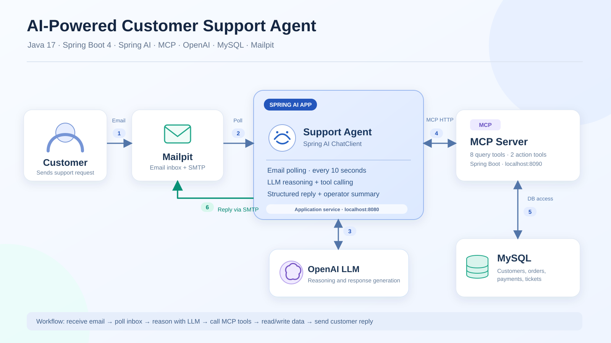
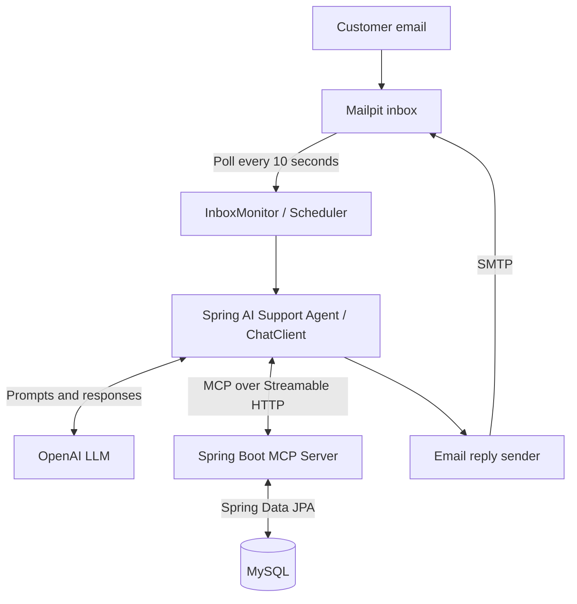
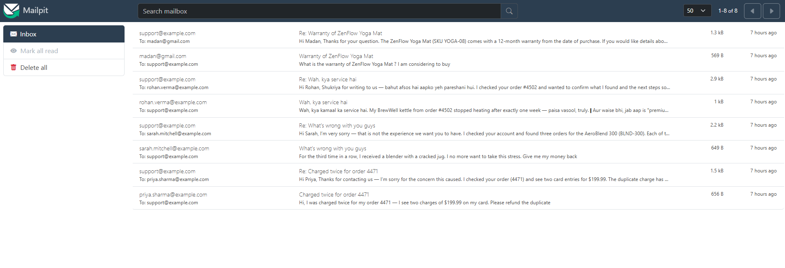

# AI-Powered Customer Support Agent

**An AI-driven, email-based customer support demonstration using Java, Spring Boot, Spring AI, OpenAI, and the Model Context Protocol (MCP).**

This repository is the **documentation and demo hub** for two independent Spring Boot applications. The Java source code is **not duplicated here**: each application lives in its own GitHub repository and can be cloned separately.

> **Portfolio demo:** Customer emails are captured locally with Mailpit. The refund workflow updates demo database records; it does **not** process real payments. This is not a production-ready customer support system.

## Source code repositories

| Application | GitHub repository | Responsibility |
| --- | --- | --- |
| **Spring AI Support Agent** | **[yoramnag/support-agent](https://github.com/yoramnag/support-agent)** | Polls emails, uses OpenAI through Spring AI `ChatClient`, calls MCP tools, and generates email replies. |
| **Spring Boot MCP Server** | **[yoramnag/mcp-server](https://github.com/yoramnag/mcp-server)** | Exposes tools for querying and updating customer, order, payment, product, warranty, and support-ticket information in MySQL. |

**This repository contains only:** shared documentation, a Postman collection, and demonstration screenshots.

## System architecture



The SVG diagram shows the full email-to-response workflow. A GitHub-rendered Mermaid version is included below as a fallback.



### How it works

1. A test customer email is sent into **Mailpit**.
2. The support agent polls the test inbox for emails and passes them to a Spring AI `ChatClient`.
3. The LLM interprets the customer's issue and can select the relevant MCP tools.
4. The MCP server reads or updates the **demo MySQL database**.
5. The agent generates a contextual response and sends it through Mailpit.

Spring AI orchestrates model/tool interactions; application-level checks are still necessary to validate sensitive actions and guarantee correct completion.

## Features

- Spring AI integration with OpenAI and structured customer-support responses.
- Separate Spring Boot MCP server reached using Streamable HTTP.
- Scheduled customer email processing and reply generation.
- Customer, order, and payment lookups.
- Duplicate-charge detection, warranty checks, and product search.
- Support-ticket logging and **simulated** refunds.
- Local testing through Mailpit and a Postman collection.

## Technology stack

| Component | Technologies |
| --- | --- |
| AI agent | Java 17, Spring Boot, Spring AI, OpenAI |
| MCP server | Java 17, Spring Boot, Model Context Protocol, Spring Data JPA |
| Database | MySQL |
| Local email testing | Mailpit (HTTP API and SMTP) |
| Local infrastructure | Docker / Docker Compose |
| API scenarios | Postman |

## MCP tools

The [MCP server](https://github.com/yoramnag/mcp-server) exposes these **10 tools**:

| Tool | Purpose |
| --- | --- |
| `lookup_customer_by_email` | Identify a customer by email address. |
| `get_customer_orders` | Retrieve a customer's orders and associated payment information. |
| `get_order_by_number` | Retrieve an order by its number. |
| `search_products` | Search products by name or SKU. |
| `get_product_by_sku` | Retrieve product details. |
| `detect_duplicate_charges` | Check whether an order appears to have duplicate captured payments. |
| `check_warranty` | Check product warranty eligibility. |
| `get_customer_ticket_history` | Retrieve previous support tickets. |
| `issue_refund` | Record a **simulated** refund in the database. |
| `log_support_ticket` | Record a support ticket and its resolution. |

## Getting started — Windows PowerShell

### Prerequisites

- Git
- Java 17 or later
- Docker Desktop (running)
- Your **own OpenAI API key** and an API account with access to the selected model
- Windows PowerShell (the Java repositories include Maven Wrapper scripts)
- Available local ports **8080**, **8090**, **3306**, **8025**, and **1025**

### 1. Clone the documentation and the two applications

Create one workspace and clone the **three repositories side by side**:

```powershell
mkdir ai-support-demo
cd ai-support-demo

git clone https://github.com/yoramnag/ai-customer-support-agent.git
git clone https://github.com/yoramnag/support-agent.git
git clone https://github.com/yoramnag/mcp-server.git
```

After cloning, the local directories should look like this:

```text
ai-support-demo/
├── ai-customer-support-agent/  # Documentation + Postman collection
├── support-agent/              # Spring AI application source
└── mcp-server/                # MCP application source
```

> You can also skip cloning the documentation repository and clone only the two application repositories. **Do not clone the application repositories inside this documentation repository**; they are independent Git projects.

### 2. Start the database

From the `ai-support-demo` workspace:

```powershell
cd .\mcp-server
docker compose up -d
```

The MCP server project provides its own `compose.yaml` for MySQL. Its initial database setup and sample records are applied when the database starts with a fresh volume. If you have already run a demo and want the initial records again, follow the MCP server repository instructions before resetting any data volume.

### 3. Start Mailpit

In a separate PowerShell terminal:

```powershell
docker run -d --name mailpit -p 1025:1025 -p 8025:8025 axllent/mailpit
```

Visit **http://localhost:8025**. If a Mailpit container already exists, start/reuse it rather than creating another one.

### 4. Run the MCP server

In the `mcp-server` directory:

```powershell
.\mvnw.cmd spring-boot:run
```

The MCP server is configured to listen at `http://localhost:8090`, with an MCP endpoint at **`http://localhost:8090/mcp`**.

### 5. Configure the OpenAI key and run the Spring AI agent

In [support-agent](https://github.com/yoramnag/support-agent), check `src/main/resources/application.properties` contains:

```properties
spring.ai.openai.api-key=${OPENAI_API_KEY}
```

In a **new PowerShell terminal**, navigate to the cloned `support-agent` directory and set the key for that terminal session:

```powershell
$env:OPENAI_API_KEY = "YOUR_OPENAI_API_KEY"
.\mvnw.cmd spring-boot:run
```

Replace the placeholder with your own API key. The agent uses **http://localhost:8080** and connects to the MCP server on port 8090.

If running from IntelliJ IDEA, set `OPENAI_API_KEY` in **Run → Edit Configurations → Environment variables** instead.

**Never commit an actual API key**, a local `.env` file, or secret values to GitHub. A ChatGPT subscription is separate from OpenAI API billing.

### 6. Import and run the Postman collection

1. Open **Postman** and click **Import**.
2. Select the file [`postman/ai-customer-support-agent.postman_collection.json`](postman/ai-customer-support-agent.postman_collection.json) from this repository.
3. Import the collection into your workspace.
4. Confirm that **MySQL, Mailpit, the MCP server, and the Support Agent** are running.
5. Open the imported collection and send each request individually.
6. Review the corresponding incoming messages and replies in Mailpit at **http://localhost:8025**.

The collection has four requests to `POST http://localhost:8080/seed-mail`, using `form-data` fields `from`, `subject`, and `body`. It is a set of **manual demo scenarios**, not an automated assertion-based test suite.

| Postman request | Test scenario |
| --- | --- |
| `Priya_ChargedTwice` | Customer reports duplicate payment for order 4471. |
| `Sarah_Escalation` | Upset customer requests help after receiving defective products. |
| `Rohan_Hindi_Sarcastic` | Multilingual and sarcastic product complaint. |
| `UnknownCustomer` | Warranty question from an unrecognized email address. |

These requests demonstrate interactions; they do **not** contain automated assertions. Some scenarios may change demo database state, including simulated refunds.

As a PowerShell alternative, you can send a sample email directly:

```powershell
Invoke-RestMethod -Method Post `
  -Uri "http://localhost:8080/seed-mail" `
  -Body @{
    from    = "priya.sharma@example.com"
    subject = "Duplicate payment for order 4471"
    body    = "Hello, I was charged twice for order 4471. Can you investigate?"
  }
```

### 7. Inspect the generated email replies

Open **http://localhost:8025** in your browser and check the incoming messages and generated replies. The demo screenshot shows **four customer requests and four corresponding AI-generated replies**. Review the Spring Boot console output to troubleshoot any MCP/tool failures. The screenshot alone does not prove that a database action succeeded; verify such actions in the application logs and demo database.



*Mailpit inbox showing four customer requests and corresponding generated responses during a local demo.*

## Repository layout

```text
ai-customer-support-agent/
├── README.md
├── docs/
│   ├── architecture.svg
│   └── screenshots/
│       └── mailpit-inbox.png
├── postman/
│   └── ai-customer-support-agent.postman_collection.json
└── .gitignore
```

For the Java source, project-specific configuration, and implementation details, see the **[support-agent](https://github.com/yoramnag/support-agent)** and **[mcp-server](https://github.com/yoramnag/mcp-server)** repositories.

## Limitations and future improvements

This is a learning and portfolio project, not a production service. Possible next steps include:

- Server-side refund authorization, validation, and idempotency.
- An approval workflow for sensitive customer-impacting actions.
- Authentication, secrets management, audit trails, and rate limiting.
- More complete unit and integration tests.
- A unified containerized development environment.

## Author

**Yoram Nagawker** — Senior Java Backend Developer / Tech Lead

[GitHub profile](https://github.com/yoramnag)
