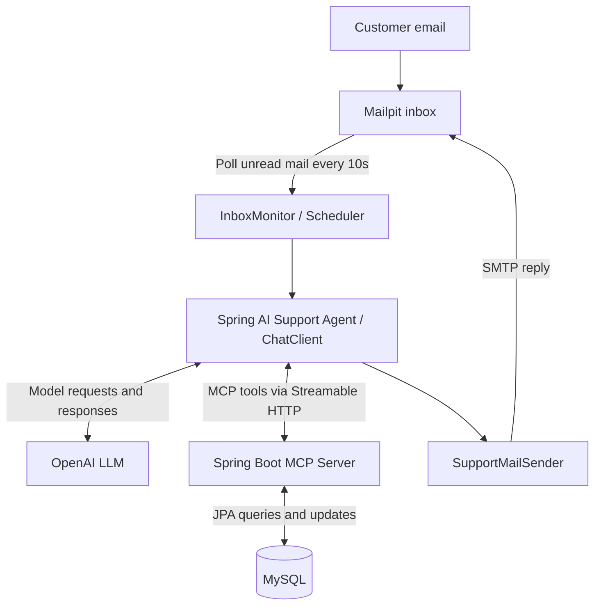

# AI-Powered Customer Support Agent

**An autonomous, email-driven customer support demo built with Java, Spring Boot, Spring AI, and the Model Context Protocol (MCP).**

The application monitors a support inbox, uses an OpenAI language model to understand incoming requests, retrieves business data through tools exposed by a separate MCP server, records support activity, and generates contextual email replies.

> **Demo scope:** This is a portfolio/learning project, not a production customer-support or payment system. Email is captured locally by Mailpit. The refund tool **simulates** processing by updating records in MySQL; it does not communicate with a payment gateway.

## Highlights

- **Agentic workflow:** Spring AI `ChatClient` lets the model select and invoke MCP tools while resolving a support email.
- **Separate MCP server:** A standalone Spring Boot application exposes customer, order, payment, product, warranty, and ticket operations.
- **Automated inbox:** A scheduled job polls unread messages every 10 seconds (configurable), with retry-on-failure behavior.
- **Structured AI output:** Each resolution produces a customer-facing reply and an internal operator summary.
- **Email replies:** SMTP replies are sent through Mailpit and linked to the original email using message-thread headers.
- **Relational data:** MySQL holds sample customers, orders, products, payments, refunds, and support tickets.

## Architecture



### How an email is processed

1. A test customer sends an email to the configured support address, captured by **Mailpit**.
2. `InboxMonitor` polls Mailpit for unread messages and passes them to `AgentEmailHandler`.
3. `SupportAgent` sends the email to an OpenAI model through Spring AI `ChatClient`.
4. The model chooses MCP tools to identify the customer, investigate the issue, and—if appropriate—record an action.
5. The MCP server accesses the demo MySQL database; the agent records a support ticket as part of its resolution workflow.
6. Spring AI maps the result to an `AgentResponse`. `SupportMailSender` sends the generated reply through Mailpit.

The tool-calling loop is handled by Spring AI. Business correctness and completion still require application-level validation; a model response alone is not a guarantee that an action succeeded.

## Technology stack

| Layer | Technologies |
| --- | --- |
| Agent application | Java 17, Spring Boot 4.1, Spring AI 2.0, Spring MVC |
| LLM integration | OpenAI via Spring AI `ChatClient`, structured responses |
| Tool integration | MCP client, Streamable HTTP |
| Tool provider | Separate Spring Boot MCP server, `@McpTool` annotations |
| Persistence | MySQL, Spring Data JPA, Hibernate |
| Email simulation | Mailpit REST API and SMTP |
| Local infrastructure | Docker, Docker Compose |

## MCP tools

The companion [mcp-server](https://github.com/yoramnag/mcp-server) repository exposes **10 tools**:

| Tool | Purpose | Type |
| --- | --- | --- |
| `lookup_customer_by_email` | Identify a customer from their email address | Read |
| `get_customer_orders` | Find a customer's orders and payments | Read |
| `get_order_by_number` | Retrieve a specific order | Read |
| `search_products` | Search products by name or SKU | Read |
| `get_product_by_sku` | Retrieve product details and specifications | Read |
| `detect_duplicate_charges` | Compare captured payments with an order total | Read |
| `check_warranty` | Check warranty eligibility for an ordered item | Read |
| `get_customer_ticket_history` | Review previous customer support tickets | Read |
| `issue_refund` | Record a **simulated** refund and optionally mark a payment as refunded | Write |
| `log_support_ticket` | Save a support interaction and its resolution | Write |

These tools are invoked by the agent through MCP, not called directly as REST endpoints by the customer.

## Repositories

This demo consists of two independent Java applications:

1. **[support-agent](https://github.com/yoramnag/support-agent)** — email polling, Spring AI agent, MCP client, and outgoing replies. *(This repository.)*
2. **[mcp-server](https://github.com/yoramnag/mcp-server)** — business-data access, read/write MCP tools, MySQL schema, and sample data.

## Run locally on Windows (PowerShell)

### Prerequisites

- JDK **17** or later (the projects target Java 17).
- Docker Desktop with the Docker engine running.
- An **OpenAI API key** with access to a supported model.
- PowerShell. Maven Wrapper scripts are included in both repositories.
- Ports **8080**, **8090**, **3306**, **8025**, and **1025** available.

> **Current setup:** MySQL is defined in the MCP server's `compose.yaml`. The agent repository's `compose.yaml` is currently empty, so Mailpit is started separately below. The two Spring Boot applications are launched with Maven rather than run as containers.

### 1. Clone both repositories

```powershell
git clone https://github.com/yoramnag/mcp-server.git
git clone https://github.com/yoramnag/support-agent.git
```

Keep both project directories available. Use separate PowerShell terminals for the two Java applications.

### 2. Start MySQL

From the `mcp-server` directory:

```powershell
cd mcp-server
docker compose up -d
```

The MySQL container initializes its schema and demo records from `db/init/` on the **first** startup with a fresh data volume. Docker Compose stores data in a named volume, so later starts retain previously changed data.

### 3. Start Mailpit

In another PowerShell terminal, if Mailpit is not already running:

```powershell
docker run -d --name mailpit -p 1025:1025 -p 8025:8025 axllent/mailpit
```

Mailpit's web interface: **http://localhost:8025**. If you already have a Mailpit container using these ports, reuse it instead of creating a second one.

### 4. Start the MCP server

From the `mcp-server` directory:

```powershell
.\mvnw.cmd spring-boot:run
```

The MCP server runs on **http://localhost:8090**, with its Streamable HTTP endpoint at **`/mcp`**. Its database connection settings are defined in `src/main/resources/application.properties`.

### 5. Configure your OpenAI API key and start the AI support agent

The AI agent requires **your own OpenAI API key**. In `support-agent/src/main/resources/application.properties`, make sure this line is present:

```properties
spring.ai.openai.api-key=${OPENAI_API_KEY}
```

This tells Spring Boot to read your API key from the `OPENAI_API_KEY` environment variable rather than storing a secret in source code.

From the `support-agent` directory, in a **new PowerShell terminal**, set that environment variable and then start the application:

```powershell
$env:OPENAI_API_KEY = "YOUR_OPENAI_API_KEY"
.\mvnw.cmd spring-boot:run
```

Replace `YOUR_OPENAI_API_KEY` with your own key. The PowerShell variable is set only for that terminal session. If you launch the agent from IntelliJ IDEA instead, set `OPENAI_API_KEY` in the application's **Run/Debug Configuration → Environment variables**.

**Never commit a real API key to GitHub**, hardcode it in `application.properties`, or include it in screenshots or Postman collections. Also note that an OpenAI API key requires appropriate API account access; a ChatGPT subscription by itself does not provide API usage credits.

The agent runs on **http://localhost:8080** and connects to the MCP server at `http://localhost:8090/mcp`.

### 6. Send a sample support email

The companion repository seeds a demo customer at `priya.sharma@example.com` with order **4471** containing two captured charges. You can use that example to exercise the duplicate-charge flow:

```powershell
Invoke-RestMethod -Method Post `
  -Uri "http://localhost:8080/seed-mail" `
  -Body @{
    from    = "priya.sharma@example.com"
    subject = "Duplicate payment for order 4471"
    body    = "Hello, I think I was charged twice for order 4471. Can you investigate?"
  }
```

Then open **http://localhost:8025** to inspect the incoming email and the agent's generated reply. Inspect both Spring Boot consoles for agent activity and tool errors. Since this scenario can trigger a simulated database refund, running the same example repeatedly may alter your local demo data.

> **Important:** The `/seed-mail` endpoint's default sender, `customer@example.com`, is **not** included in the current seed data. Use a seeded customer address when testing customer lookups.

## Relevant application code

| File / class | Responsibility |
| --- | --- |
| `service/InboxMonitor.java` | Scheduled Mailpit polling and retrying failed messages |
| `client/MailpitClient.java` | Mailpit REST API requests |
| `service/AgentEmailHandler.java` | Connects email processing to the agent and outgoing replies |
| `service/SupportAgent.java` | Configures `ChatClient`, MCP tools, and structured responses |
| `resources/prompts/support-agent-system.st` | Agent instructions and response expectations |
| `service/SupportMailSender.java` | Sends threaded SMTP replies |
| `controller/SeedMailController.java` | Development endpoint to send example emails |
| [MCP server tool classes](https://github.com/yoramnag/mcp-server/tree/main/src/main/java/com/example/mcp/server/tool) | Database-backed MCP queries and actions |

## Configuration

| Configuration | Default | Meaning |
| --- | --- | --- |
| `OPENAI_API_KEY` | Required environment variable | OpenAI API authentication |
| `support-agent.inbox.address` | `support@example.com` | Support mailbox address |
| `support-agent.inbox.poll-interval` | `10000` | Polling interval in milliseconds |
| `support-agent.inbox.batch-size` | `50` | Maximum messages per poll |
| `support-agent.inbox.base-url` | `http://localhost:8025` | Mailpit REST API host |
| MCP connection URL | `http://localhost:8090` | MCP server host |
| MCP endpoint | `/mcp` | MCP Streamable HTTP endpoint |

These values are configured in the agent's `src/main/resources/application.properties`.

## Testing and current limitations

Both repositories currently include basic Spring application-context tests. More complete unit and integration coverage is planned.

This implementation is intended for **local demonstration**. Before adapting it for real users or payments, important improvements would include:

- Validate refund amounts, payment ownership, existing refunds, and business authorization **inside server code**, not only in the LLM prompt.
- Add idempotency tied to the source email or transaction so retries cannot repeat financial actions.
- Add an approval workflow for sensitive operations and separate drafts from approved actions.
- Introduce authentication/authorization, rate limits, secrets management, and audit trails.
- Make ticket state reflect whether the outbound email was actually sent, and add robust retry/failed-message handling.
- Add reproducible end-to-end tests and a complete Docker Compose environment.

## Author

**Yoram Nagawker** — Senior Java Backend Developer / Tech Lead

- [GitHub profile](https://github.com/yoramnag)

